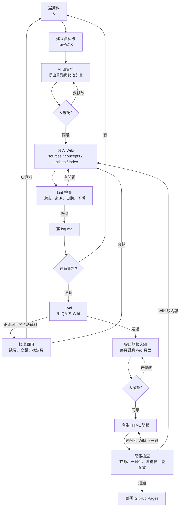

# loop / graph 設計

> 版本 v0 (2026-11-13)，實際跑過之後依問題修改，每次修改都在下方「修改紀錄」寫原因，也在 `wiki/log.md` 記一筆 `rule-change`。

## 流程圖

## 三個 loop

| loop | 重複的步驟 | 什麼時候重來 | 為什麼這樣設計 |
|---|---|---|---|
| Ingest loop | C 到 G，每篇資料跑一次 | 人不同意 (D)、Lint 不通過 (F) | 一次一篇，比較容易發現錯誤，也比較省額度 |
| Eval loop | I、J，回頭修 Wiki 再考 | 正確率不夠、題目 Wiki 答不出來 | 用 QA 當獨立的檢查，避免 AI 自己說自己對 |
| Slides loop | K 到 N | 簡報和 Wiki 對不上、Wiki 缺內容 | 簡報只能從 Wiki 來，缺的東西要先補 Wiki，不能直接寫進簡報 |

## 檢查點

| 檢查點 | 檢查什麼 | 誰來檢查 |
|---|---|---|
| D 人確認 | 重點有沒有抓對、頁面規劃合不合理 | 人 |
| F Lint | 死連結、孤立頁面、缺來源、缺日期、矛盾、投資建議、太難 | AI，結果寫進 log |
| I Eval | QA 正確率、錯題原因 | AI 作答，人看結果 |
| L 人確認 | 簡報大綱的教學順序 | 人 |
| N 簡報檢查 | 每頁有來源、和 Wiki 一致、外行人看得懂、能正常瀏覽 | AI 檢查 + 人實際打開看 |

## 修改紀錄

(實際執行後填寫：哪個節點最常出錯、檢查往前移到哪一步、改了什麼、為什麼)
