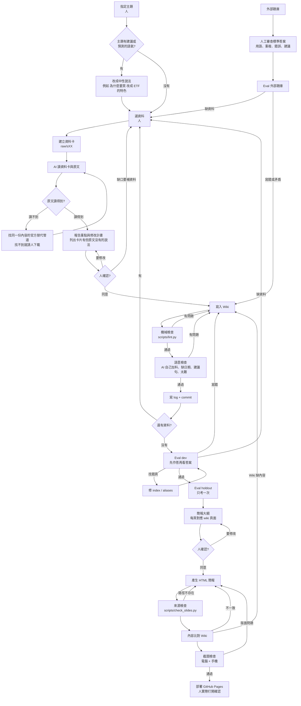

# loop / graph 設計

> 目前版本 v1.3 (2026-11-23)。v0 是開工前的設計；v1.2 是跑完第一輪 (6 篇 ingest、dev、holdout、簡報) 後的版本；v1.3 是加上外部題庫人工審查與第二輪 ingest (s07 到 s09) 後的版本。每次修改的原因見最下方「修改紀錄」和 `wiki/log.md`。

## 流程圖 (v1.3)

## 三個 loop

| loop | 重複的步驟 | 什麼時候重來 | 為什麼這樣設計 |
|---|---|---|---|
| Ingest loop | C 到 G，每篇資料跑一次 | 原文讀不到、人不同意、lint 不通過、語意檢查不通過 | 一次一篇，錯誤比較容易定位，也比較省額度 |
| Eval loop | I、修正、再考 | 缺資料、寫錯、找錯頁 | 用事先出好的題目當獨立檢查，避免 AI 自己說自己對；holdout 避免「針對考題補 Wiki」 |
| Slides loop | M 到 N3 | 來源路徑錯、內容和 Wiki 對不上、版面問題 | 簡報只能從 Wiki 來，缺的東西要先補 Wiki |

## 檢查點

| 檢查點 | 檢查什麼 | 誰來檢查 | 實際抓到幾次 (第一輪) |
|---|---|---|---|
| C1 原文讀取 | 原文是否讀得到 | AI | 2 次 (s02a、s03a) |
| C3 卡片 vs 原文 | 卡片上的說法原文有沒有 | AI 報告，人決定 | 3 次 (v1.2 才正式加入，之前是在 ingest 時順手發現) |
| F1 lint.py | 死連結、漏列、孤立、frontmatter、缺來源 | 腳本 | 12 個問題 (s01 1、s02 6、s04 4、s05 1) |
| F2 語意檢查 | AI 自己加料、缺日期、建議句、太難 | AI | 1 次 (s03 淨值頁) |
| I Eval | 正確率與錯題原因 | AI 作答，人看部分正確的題目 | 1 題 (d04 缺資料) |
| N1 to N3 簡報檢查 | 來源路徑、內容一致、版面 | 腳本 + AI 截圖 + 人 | 2 頁來源不完整、3 個版面問題 |
| X1 外部題庫人工審查 | 用語、重複題、事實錯誤、投資建議 | 人 | 用語 4 處、重複 3 組、答案有問題 9 題 |
| X2 外部題庫 eval | 審查後的標準答案考 Wiki | AI 作答，人審過的答案批改 | 審查前 80%，審查後 58.8%，第二輪 ingest 後 76.5% |

## 修改紀錄

### v0 → v1 (開工前)
依 AI 對 v0 規則的逐節檢討修改。重點：eval 題目與答案拆檔、加 holdout、lint 拆成機械與語意兩類並寫成腳本、raw/ 只有人能改。

### v1 → v1.1 (ingest s02 時)
- **問題**：0050 的分級費率適合用表格，但「每個事實句都要標來源」讓表格每一列都要重複標。
- **修改**：表格的前導句有標來源，就代表整張表。lint.py 同步支援；ingest s04 時又發現腳本的表格判斷會跨段落借用來源，修正腳本。

### v1.1 → v1.2 (跑完一輪後)

**哪一個節點最常出錯：「寫入 Wiki」(E)。** lint.py 在 4 次 ingest 中共抓到 12 個問題，加上語意檢查抓到 1 個。錯誤類型集中在兩種：
1. AI 把來源沒有的東西寫進去：證交所官網網址 (s01)、淨值「換算成每單位」(s03)。這種錯最危險，因為內容看起來是對的。
2. 格式：連到還沒建立的頁面、表格忘了前導句 (s02、s05 各一次)。

**檢查往前移到哪裡：**
- **缺資料的檢查，從 Eval (I) 移到 Ingest 討論 (C3)。** eval 唯一抓到的 d04，其實在 ingest s02 時 AI 就已經記下「卡片寫的 0.3% 原文沒有」，只是當時沒有規定要處理，所以拖到 eval 才補。v1.2 規定討論階段就要列出卡片和原文的落差，當場決定要不要補卡。
- **簡報的版面檢查，從「最後人打開看」移到「AI 截圖檢查」(N3)。** 截圖抓到 SVG 文字在手機上太小、箭頭文字重疊、內容超出畫面，這些如果等人打開才發現，就要再多跑一輪。
- **簡報來源檢查加上腳本 (N1)。** 第 11 頁用了折溢價頁的結論卻沒標，第 17 頁的回顧頁原本被當成結構頁，其實有事實。

**有沒有因此修改 workflow：** 有。流程圖新增 C1、C2 (原文讀不到時的分支)、C3 (卡片 vs 原文)、F2 (語意檢查獨立成節點)、I2 (找錯頁的出路)、I3 (holdout)、N1 到 N3 (簡報三段檢查)。AGENTS.md 同步升到 v1.2。

**還沒解決的限制 (已部分驗證)：** 出題、寫 Wiki、作答的都是同一個 AI，eval 分數偏樂觀。

### 外部題庫驗證 (v1.2 之後)

用使用者提供的觀念題庫 (1,068 題) 挑 25 題再考一次，結果證實了上面的限制：

| 題組 | 出題者 | 正確率 |
|---|---|---|
| holdout | AI，從 raw 原文出題 | 100% (6/6) |
| holdout-ext | 使用者題庫 | 80% (範圍內 16/20) |

4 題沒答好，**全部是缺資料，沒有一題是寫錯**。缺的是淨值怎麼算、除息會讓淨值下降、ETF 和共同基金的差別，都是新手最常問的基本問題。這代表：

- **最常出錯的節點要修正為兩個**：「寫入 Wiki」最常出錯 (12 個 lint 問題，都在 ingest 當下被抓到)；但影響最大、而且到最後才發現的是「選資料」(A)。AI 自己出題時，題目只會從已選的 5 篇來源出，所以永遠看不到 5 篇以外的缺口。
- **檢查應該再往前移到選資料階段**：下一輪在選資料前，先用外部題庫的題目清單 (只看題目、不看答案) 檢查「新手會問的問題，有沒有來源能回答」，再決定要補哪幾篇。
- 外部題庫的答案也要檢查：25 題中有 3 題是投資建議，另有題庫答案和證交所說法衝突，所以題庫只能用來找缺口，標準答案不能直接當真。

### v1.2 → v1.3 (人工審查外部題庫、第二輪 ingest)

**人工審查發現的題庫問題** (詳見 `eval/holdout-ext-review.md`)：
- **用語不一致**：Wiki 的來源都是台灣證交所體系，題庫卻混用大陸用語，例如「分紅」(台灣說配息、除息)、「創建與贖回」(台灣說申購與買回)、「交易所交易基金」(證交所正式名稱是指數股票型基金)、「信託費」(台灣 ETF 是保管費)。如果 Wiki 只認台灣用語，用別的說法問的人就找不到頁面，所以在 aliases 補上這些詞。
- **重複題**：x02 和 x09、x05 和 x07、x03 和 x06 幾乎在問同一件事，重複題會讓同一個知識點被算兩次分數。
- **標準答案本身有錯**：最嚴重的是 x24 說高股息 ETF 適合保守型投資人，但高股息 ETF 仍是股票型，領息不等於保本；另外 x15「熱門 ETF 溢價較小」有反例、x14 沒寫債券型的特性、x12 沒區分表定費率和實際總費用率、x01 把費率範圍寫死、x23 把過去績效當選擇依據。

**這讓結論再修正一次**：
- 用原始標準答案批改是 80%，用審查後的答案重新批改只剩 58.8%。原本的分數被錯誤、寬鬆的標準答案墊高了，**沒有人審查過的外部題庫，分數本身就不可信**。
- 審查還抓到 Wiki 自己的矛盾：x16 的問題提醒了「ETF 不一定追蹤指數」，回頭檢查發現 what-is-etf.md 只寫追蹤指數，和 active-vs-passive.md 矛盾，而語意檢查當時沒抓到。這是 AI 自己檢查自己最容易漏掉的類型：每一頁單獨看都對，放在一起才矛盾。
- 第二輪 ingest 補了除息、ETF 和共同基金的比較、ETF 特色、複利之後，同一組題目 (已改稱 dev-ext) 從 58.8% 進步到 76.5%。但這組題目已經拿來修 Wiki，不能證明 Wiki 整體變好，要驗證還需要一組新的、人審過的題目。

**檢查又往前移了兩個地方**：
1. **外部題庫在批改前先由人審查** (新增節點 X1)。
2. **使用者指定主題時先檢查語氣** (新增節點 A1)。這次的「為什麼要買 ETF」「為什麼會漲」本身就帶有推薦和預測的意思，如果直接照字面寫，就會違反「不給投資建議」的規則，所以在規劃頁面前先改成「ETF 的特色」「價格變動的機制」。

**整體來看，最常出錯的節點 (依數量)** 是「寫入 Wiki」；**影響最大、最晚才發現的** 是「選資料」和「評分用的標準答案」。這兩個都在流程的最前面和最後面，正好是 AI 最難自己檢查的地方，也是最需要人介入的地方。
