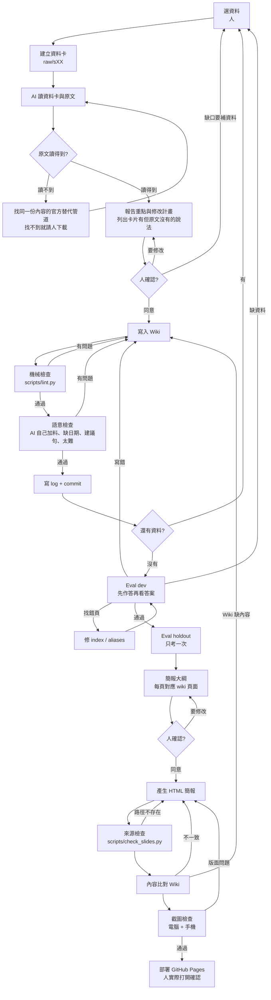

# loop / graph 設計

> 目前版本 v1.2 (2026-11-16)。v0 是開工前的設計，v1.2 是實際跑完一輪 (6 篇 ingest、2 次 dev eval、1 次 holdout、簡報製作) 後修改的版本。每次修改的原因見最下方「修改紀錄」和 `wiki/log.md`。

## 流程圖 (v1.2)

## 三個 loop

| loop | 重複的步驟 | 什麼時候重來 | 為什麼這樣設計 |
|---|---|---|---|
| Ingest loop | C 到 G，每篇資料跑一次 | 原文讀不到、人不同意、lint 不通過、語意檢查不通過 | 一次一篇，錯誤比較容易定位，也比較省額度 |
| Eval loop | I、修正、再考 | 缺資料、寫錯、找錯頁 | 用事先出好的題目當獨立檢查，避免 AI 自己說自己對；holdout 避免「針對考題補 Wiki」 |
| Slides loop | M 到 N3 | 來源路徑錯、內容和 Wiki 對不上、版面問題 | 簡報只能從 Wiki 來，缺的東西要先補 Wiki |

## 檢查點

| 檢查點 | 檢查什麼 | 誰來檢查 | 實際抓到幾次 (第一輪) |
|---|---|---|---|
| C1 原文讀取 | 原文是否讀得到 | AI | 2 次 (s02a、s03a) |
| C3 卡片 vs 原文 | 卡片上的說法原文有沒有 | AI 報告，人決定 | 3 次 (v1.2 才正式加入，之前是在 ingest 時順手發現) |
| F1 lint.py | 死連結、漏列、孤立、frontmatter、缺來源 | 腳本 | 12 個問題 (s01 1、s02 6、s04 4、s05 1) |
| F2 語意檢查 | AI 自己加料、缺日期、建議句、太難 | AI | 1 次 (s03 淨值頁) |
| I Eval | 正確率與錯題原因 | AI 作答，人看部分正確的題目 | 1 題 (d04 缺資料) |
| N1 to N3 簡報檢查 | 來源路徑、內容一致、版面 | 腳本 + AI 截圖 + 人 | 2 頁來源不完整、3 個版面問題 |

## 修改紀錄

### v0 → v1 (開工前)
依 AI 對 v0 規則的逐節檢討修改。重點：eval 題目與答案拆檔、加 holdout、lint 拆成機械與語意兩類並寫成腳本、raw/ 只有人能改。

### v1 → v1.1 (ingest s02 時)
- **問題**：0050 的分級費率適合用表格，但「每個事實句都要標來源」讓表格每一列都要重複標。
- **修改**：表格的前導句有標來源，就代表整張表。lint.py 同步支援；ingest s04 時又發現腳本的表格判斷會跨段落借用來源，修正腳本。

### v1.1 → v1.2 (跑完一輪後)

**哪一個節點最常出錯：「寫入 Wiki」(E)。** lint.py 在 4 次 ingest 中共抓到 12 個問題，加上語意檢查抓到 1 個。錯誤類型集中在兩種：
1. AI 把來源沒有的東西寫進去：證交所官網網址 (s01)、淨值「換算成每單位」(s03)。這種錯最危險，因為內容看起來是對的。
2. 格式：連到還沒建立的頁面、表格忘了前導句 (s02、s05 各一次)。

**檢查往前移到哪裡：**
- **缺資料的檢查，從 Eval (I) 移到 Ingest 討論 (C3)。** eval 唯一抓到的 d04，其實在 ingest s02 時 AI 就已經記下「卡片寫的 0.3% 原文沒有」，只是當時沒有規定要處理，所以拖到 eval 才補。v1.2 規定討論階段就要列出卡片和原文的落差，當場決定要不要補卡。
- **簡報的版面檢查，從「最後人打開看」移到「AI 截圖檢查」(N3)。** 截圖抓到 SVG 文字在手機上太小、箭頭文字重疊、內容超出畫面，這些如果等人打開才發現，就要再多跑一輪。
- **簡報來源檢查加上腳本 (N1)。** 第 11 頁用了折溢價頁的結論卻沒標，第 17 頁的回顧頁原本被當成結構頁，其實有事實。

**有沒有因此修改 workflow：** 有。流程圖新增 C1、C2 (原文讀不到時的分支)、C3 (卡片 vs 原文)、F2 (語意檢查獨立成節點)、I2 (找錯頁的出路)、I3 (holdout)、N1 到 N3 (簡報三段檢查)。AGENTS.md 同步升到 v1.2。

**還沒解決的限制：** 出題、寫 Wiki、作答的都是同一個 AI，eval 分數偏樂觀。下一輪應該讓人自己出題，用沒看過 Wiki 製作過程的新對話作答。
